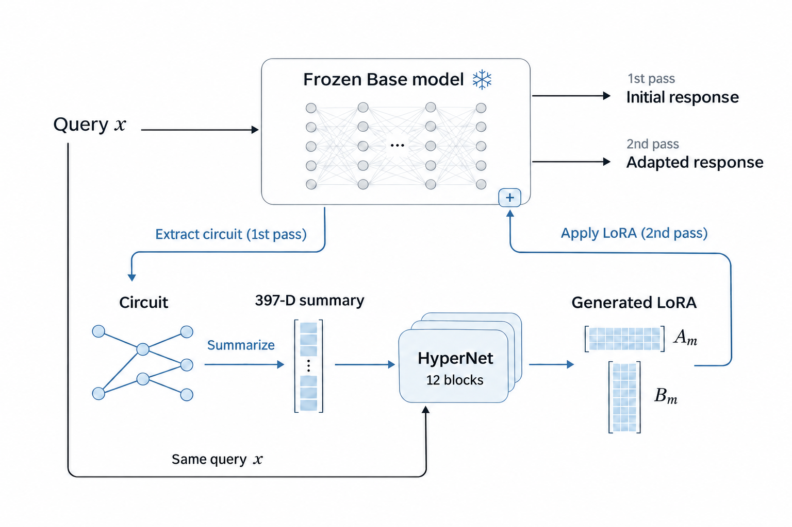

# Circuit-HyperNet

A frozen model answers a query once. Circuit-HyperNet reads the query and a summary of that first attempt’s attribution graph, then generates a temporary LoRA update for the model’s second attempt on the same query.

<p>
  <a href="https://hitzjq.github.io/Circuit-HyperNet-Blog/" title="Read the research blog"></a>&#8201;
  <a href="https://hitzjq.github.io/Circuit-HyperNet-Blog/Circuit-HyperNet.pdf" title="View the research report (PDF)"></a>&#8201;
  <a href="https://doi.org/10.5281/zenodo.24566714" title="Cite this work on Zenodo"></a>
</p>

<p align="center">
  <a href="https://hitzjq.github.io/Circuit-HyperNet-Blog/#method">
    
  </a>
</p>

## Experiments

| Benchmark | Evaluation | Result |
| --- | --- | --- |
| [Lean proof tactics](experiments/lean/README.md#results) | First-tactic exact match across five held-out composition families | **13.14%** for Circuit-HyperNet, 10.58% for Raw-weight, 6.34% for Direct SFT |
| [ARC-AGI-1](experiments/arc_agi_1/README.md#results) | Test-time fine-tuning on 400 public validation tasks, with matched settings and the same SFT base | **47.875%** with generated initialization, 45.875% with standard initialization |

On Lean, correct predictions came from two of the five held-out families. The benchmark links give the per-family breakdown and all six ARC evaluations.

## Explore the implementation

- **Lean.** Trace the [circuit summary](experiments/lean/circuits/descriptor_v2_397.py), [LoRA generator](experiments/lean/adapters/parameter_generator.py), and [second pass](experiments/lean/adapters/runtime.py). The [probe and ablation experiments](experiments/lean/README.md#probing-ablation-and-localization) examine which features support the predictions.
- **ARC-AGI-1.** Follow the generated adapter into [direct inference](experiments/arc_agi_1/direct_inference/evaluate.py) or use it to [initialize test-time fine-tuning](experiments/arc_agi_1/test_time_finetuning/warmstart.py).

The [article in Markdown](blog/article_en.md) is included for offline reading.

## CPU checks

From the repository root, install the review dependencies and run the component tests.

```shell
python -m pip install -r requirements-review.txt
python -m pytest -q
```

The evaluation records are included. Full model runs require separate weights, data and circuit caches. [Running experiment scripts and restoring assets](docs/reproduction.md)
